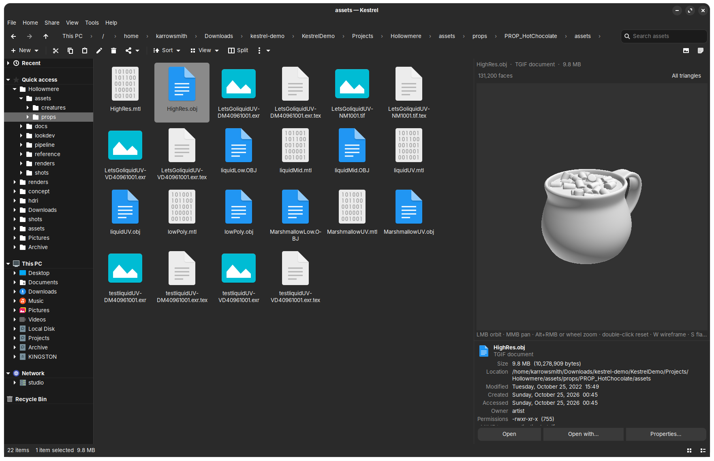
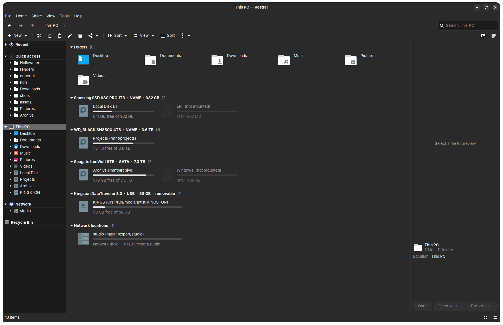
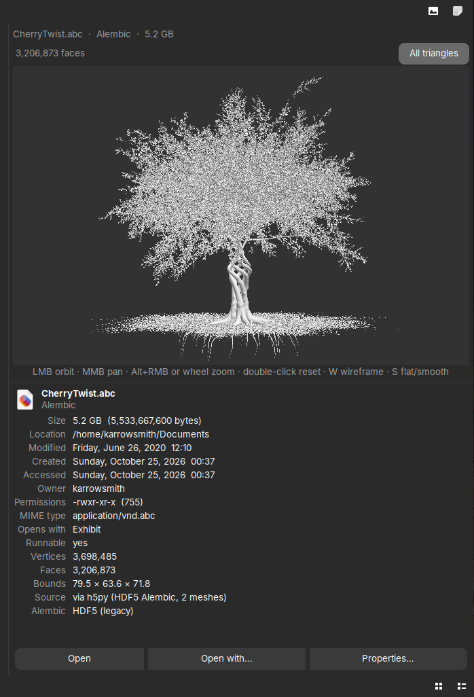
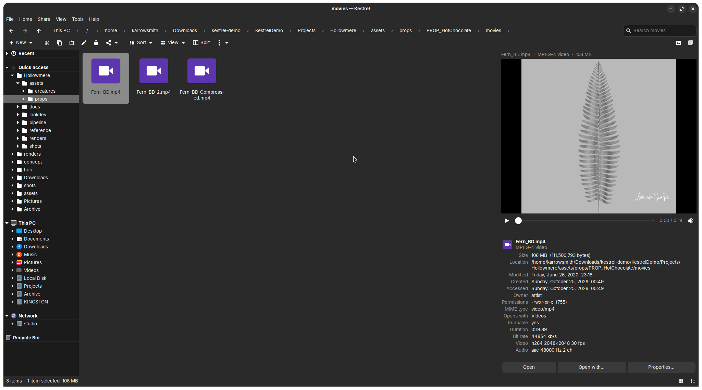
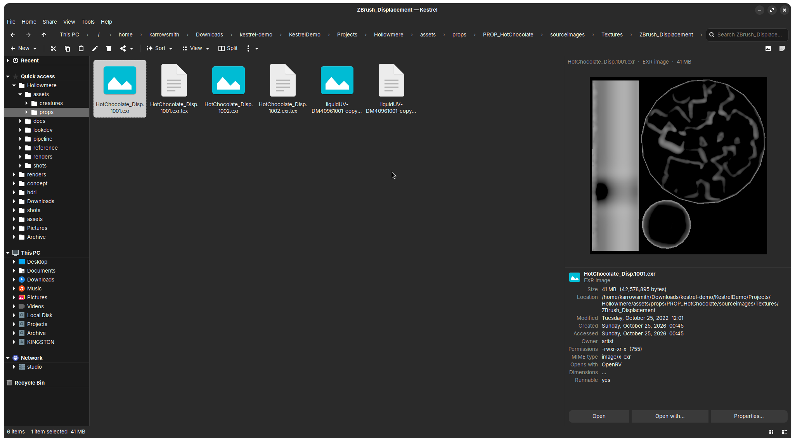
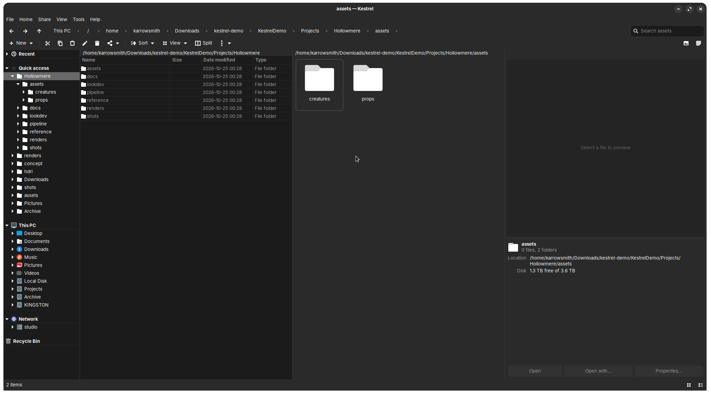
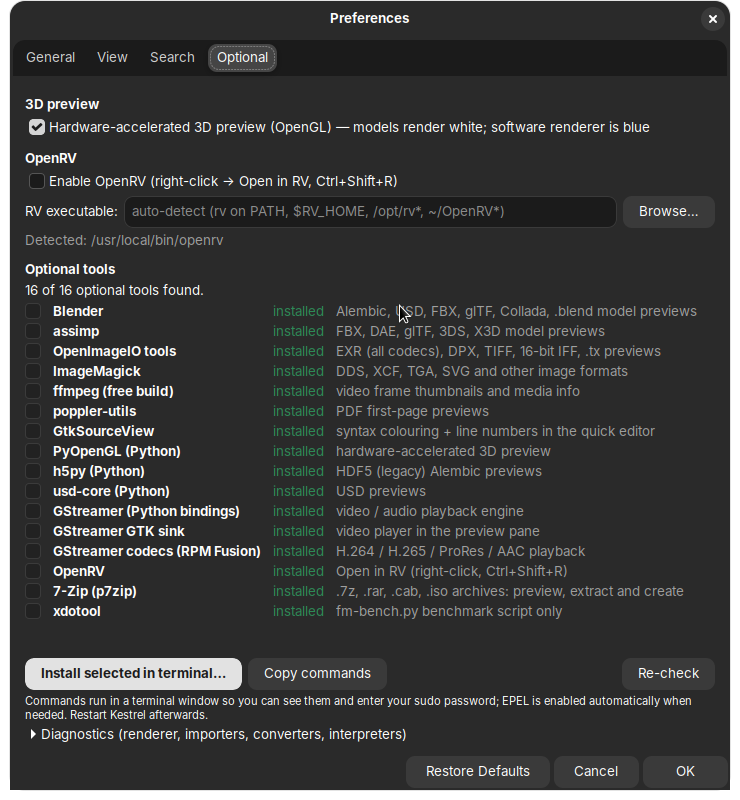

# Kestrel File Browser

[](https://ko-fi.com/kalibarrowsmith)

A fast, Windows-Explorer-style file manager for the Linux desktop, built for Rocky Linux 9
and VFX/animation workstations.

Single-file GTK 3 application (`kestrel.py`, ~21k lines), **no pip dependencies**: it needs only
`python3`, `python3-gobject` and `gtk3`, which every GNOME install already has. Everything else
(video, 3D formats, EXR tools, archives, OpenRV…) is optional and detected at runtime.

```bash
sudo dnf install python3-gobject gtk3     # Rocky / RHEL / Fedora (usually already present)
./install.sh                              # ~/.local/bin/kestrel + app-menu entry
kestrel ~/Pictures
```

Or unzip the portable build and run `./kestrel` — nothing is installed (see [Portable build](#portable-build)).

## Screenshots

<!-- Taken in demo mode (docs/DEMO.md) — nothing here is a real machine. -->


| This PC | 3D preview | Video preview |
|---|---|---|
|  |  |  |

| EXR / PSD preview | Split view | Preferences → Optional |
|---|---|---|
|  |  |  |

---

## Contents

- [Features](#features)
- [Requirements](#requirements)
- [Install](#install)
- [Portable build](#portable-build)
- [Optional tools](#optional-tools)
- [Keyboard shortcuts](#keyboard-shortcuts)
- [Command-line flags](#command-line-flags)
- [Configuration and data locations](#configuration-and-data-locations)
- [Building from source](#building-from-source)
- [Tests and diagnostics](#tests-and-diagnostics)
- [Troubleshooting](#troubleshooting)
- [Documentation](#documentation)
- [License](#license)

---

## Features

**Explorer layout.** Menu bar (File / Home / Share / View / Tools / Help), Windows 11-style command
bar, breadcrumb address bar with path typing and Tab completion, tabs (drag a tab out into its own
window, drag it back), split view (two folders side by side, Ctrl+Shift+S), navigation pane (Quick
access with pinned/frequent/recent, This PC, Recycle Bin), details pane, preview pane.

**Views.** Extra large → small icons, List, Details, Tiles, Content; sort and group by any column;
column chooser; item check boxes; file name extensions; hidden items. Details view uses fixed-height
rows so 100k-file folders scroll like 100-file ones.

**File operations.** Background copy / move / delete / rename / new with a progress dialog (bytes,
speed, remaining, pause, cancel) and Replace / Skip / Keep-both conflicts. Clipboard and
drag-and-drop interoperate with Nautilus and other GTK apps. Undo (Ctrl+Z). Real freedesktop
Recycle Bin. Folders auto-refresh when changed on disk. Batch rename (Ctrl+F2) with patterns,
numbering, regex, frame-number offsets (`shot.1001.exr` +60 → `shot.1061.exr`, padding kept) and
repathing (move the renamed files into another folder, e.g. `../v005` or `/mnt/show/{parent}`). SHA-256 to clipboard. Run scripts in a terminal.

**Archives.** Zip / tar.gz / tar.xz / tar natively; `.7z`, `.rar`, `.cab`, `.iso` and more through
7-Zip when installed. Double-clicking an archive extracts it (configurable); Extract here / Extract
to…; progress with pause.

**Preview pane.** Images (GdkPixbuf formats plus built-in decoders for **EXR**, **Radiance HDR**,
**Maya IFF**, **Photoshop PSD/PSB**), text with syntax highlighting and an inline quick editor,
PDF, folder contents with sizes, archive listings, media info, **video and audio playback**
(GStreamer), and a **3D model previewer** for OBJ, STL, PLY, FBX, glTF, Alembic (`.abc`, both Ogawa
and legacy HDF5), USD and `.blend` — software rasteriser (multi-process, 5 M-triangle meshes in under a
second) or OpenGL. Smooth shading, orbit/zoom, wireframe, "all triangles" override. Every preview switch
crossfades in ⅛ s; preview and details panes are resizable and remembered.

**Houdini caches and VDBs.** `.bgeo` / `.bgeo.sc` / `.geo` meshes and particles (coloured by `Cd`, via
Houdini) and `.vdb` volumes rendered as **smoke** (level sets as surfaces). VDBs are read by Kestrel itself —
Houdini, EmberGen and Blender files, blosc/zip, half-float — so no Houdini is needed; with OpenGL, particles
and smoke are drawn on the GPU. Select the frames of a cache and press **Preview as sequence** for a time
slider with playback (Space, ← →, adjustable fps; pauses when the window loses focus).

**Scene breakdowns.** See what's in a scene before you open it: Unreal (`.umap`, `.uasset`, `.uproject`),
Unity (`.unity`, `.prefab`, `.unitypackage`), Maya (`.ma`, `.mb`) and Blender (`.blend`) show an outliner,
actors / components / materials, render settings and **every referenced file with its full path, flagged
when it's missing** — read directly from the file, no Unreal, Unity, Maya or Blender needed. Filter, copy as
text, double-click a reference to jump to it. Blender and Unreal files show their saved thumbnail, and
picking a material in a Maya or Blender breakdown renders it on a material ball.

**Shaders, materials and lights.** MaterialX (`.mtlx`), OSL (`.osl`, `.oso`), Unity materials (`.mat`),
ShaderLab (`.shader`) and Shader Graph show their inputs and textures on a **material ball** (GGX, clearcoat,
normal maps, transmission, UDIM textures). GLSL fragment shaders — Shadertoy and glslsandbox / Book of
Shaders style — **run live** on the GPU, with compile errors on the right line; GLSL / HLSL sources get a
breakdown (uniforms, inputs, functions, includes) and a highlighted **Code** view. **IES light profiles**
show the light pattern on a wall and a polar candela diagram with beam / field angles, lumens and wattage.

**Removable drives.** Live detection (no restart), USB badge on removable media, Eject and Format
(UDisks2, no root prompt in the app), physical-disk grouping on This PC so you can see which
disk holds which mounts. Other OS partitions on a dual-boot machine stay hidden until explicitly
mounted.

**Optional encrypted file index.** Speeds up navigation and search on slow/network storage. The
disk is always the truth — the index only gives a head start, every folder is re-read as you
visit it, and search results are verified. Stored AES-256 encrypted with HMAC under
`~/.cache/kestrel`, key in the keyring (libsecret) or a 0600 key file.

**Snappy by design.** The GTK thread never touches the disk or network: listings, stats,
thumbnails, previews, searches and sizes run in threads or worker processes. Optional CPU parking
pins the interface to its own cores so a heavy preview can't make the window stutter. A stall
watchdog and freeze dumps are built in (see [Tests and diagnostics](#tests-and-diagnostics)).

**Crash and error reports.** Unhandled errors, hard crashes (segfaults in a C library) and
interface freezes are caught and written to a report. Kestrel shows a bar with *Review & report…*;
you see the full report, can edit it, and open it as a pre-filled GitHub issue with one click —
nothing is ever sent automatically, and your home folder and user name are scrubbed first.
**Help → Report a problem…** builds a report on demand.

**OpenRV integration (optional).** Right-click → *Open in RV* or **Ctrl+Shift+R** sends images,
sequences and movies to RV when it's detected.

---

## Requirements

| | |
|---|---|
| OS | Linux with GTK 3 (developed and tested on Rocky Linux 9; also runs on Fedora, Ubuntu, Arch/CachyOS) |
| Python | 3.9 or newer (Rocky 9 ships 3.9; 3.11/3.12 also work) |
| Required packages | `python3-gobject` (PyGObject), `gtk3` |
| Optional | `python3-numpy` (much faster 3D/EXR previews), see [Optional tools](#optional-tools) |

```bash
# Rocky / RHEL / Fedora
sudo dnf install python3-gobject gtk3 python3-numpy
# Debian / Ubuntu
sudo apt install python3-gi gir1.2-gtk-3.0 python3-numpy
# Arch / CachyOS
sudo pacman -S python-gobject gtk3 python-numpy
```

---

## Install

```bash
git clone https://github.com/<you>/kestrel.git
cd kestrel
./install.sh
```

`install.sh` copies `kestrel.py` to `~/.local/bin/kestrel` and adds a desktop entry. No root needed.

- Make it the default folder handler: `xdg-mime default kestrel.desktop inode/directory`
- Uninstall: `./install.sh --uninstall` (settings in `~/.config/kestrel` are kept)
- Run without installing: `python3 kestrel.py [folder…]`

---

## Portable build

Download `kestrel-<version>-portable.zip` from the Releases page (or build it with
`./make-portable.sh`, output in `dist/`). Unzip anywhere:

```
kestrel-1.0-portable/
├── kestrel            # launcher: ./kestrel [folder]
├── kestrel.py         # the application
├── install.sh         # optional: install into ~/.local/bin later
├── PORTABLE.txt
├── README.md  LICENSE  docs/  packaging/
```

`./kestrel` runs it in place. Create a `config/` folder next to the launcher to make it fully
self-contained (settings, cache and the file index are then kept there instead of
`~/.config` / `~/.cache`). The host still needs `python3`, `python3-gobject` and `gtk3`; that is
the only way to ship a GTK app without bundling a desktop stack.

---

## Optional tools

Open **Preferences → Optional** inside Kestrel. It lists every optional dependency, shows which are
found, lets you toggle OpenGL / OpenRV / CPU parking / indexing, and offers a generated install
script for whatever is missing.

| Capability | Needs | Rocky 9 package / source |
|---|---|---|
| Video & audio preview | GStreamer + gtksink + codecs | `gstreamer1-plugins-good gstreamer1-plugins-bad-free gstreamer1-plugins-ugly-free gstreamer1-libav` (RPM Fusion for H.264) |
| Fast 3D / EXR | numpy | `python3-numpy` |
| FBX, glTF, DAE, PLY… | Blender (any install incl. Flatpak `org.blender.Blender`) or `assimp` | `flatpak install org.blender.Blender` / `assimp` |
| Alembic `.abc` (Ogawa), USD, `.blend` | Blender | as above; `pip install usd-core` also works for USD |
| FBX / Alembic / USD without Blender | Maya (`mayapy`) | found under `/usr/autodesk/maya*` or `$MAYA_LOCATION` |
| Houdini caches: `.bgeo` `.bgeo.sc` `.geo` | Houdini (`hython`, else `gconvert`) | found under `/opt/hfs*` or `$HFS` |
| `.vdb` volumes | built in (needs numpy) | `python3-blosc` or Houdini make blosc-compressed VDBs decode faster |
| Alembic `.abc` (legacy HDF5) | h5py | `python3-h5py` |
| OpenGL preview, live GLSL shaders | PyOpenGL | `python3-pyopengl` |
| EXR/DPX/TX conversions | OpenImageIO `oiiotool`, ImageMagick | `OpenImageIO-utils ImageMagick` |
| Thumbnails for movies, extra image formats | `ffmpeg` | RPM Fusion |
| PDF preview | `pdftoppm` | `poppler-utils` |
| Text editor highlighting | GtkSourceView 4 | `gtksourceview4` |
| `.7z .rar .cab .iso …` | 7-Zip | `p7zip p7zip-plugins` or `7zip` |
| Open in RV | OpenRV on PATH or picked in Preferences | https://github.com/AcademySoftwareFoundation/OpenRV |
| Index key in keyring | libsecret | `libsecret-tools` (otherwise a 0600 key file is used) |
| Eject / Format | UDisks2 | `udisks2` (standard on GNOME) |

Nothing here is required; Kestrel degrades gracefully and tells you in the preview pane what
would enable a given format.

---

## Keyboard shortcuts

Press **F1** in the app for the full list.

| | |
|---|---|
| Enter / Backspace / Alt+← → ↑ | open / back / forward / up |
| Ctrl+L, F4, Alt+D | edit path |
| Ctrl+E, Ctrl+F, F3 | search |
| Ctrl+T / Ctrl+W / Ctrl+Tab / Ctrl+1…9 | tabs |
| Ctrl+N | new window |
| Ctrl+Shift+S | split view |
| Ctrl+C / X / V, Ctrl+Shift+C | copy / cut / paste / copy path |
| Ctrl+Z | undo |
| F2, Ctrl+F2 | rename, batch rename |
| Delete, Shift+Delete | recycle, delete permanently |
| Ctrl+Shift+N | new folder |
| Ctrl+A, Ctrl+Space | select all, toggle selection |
| Ctrl+H | hidden items |
| Alt+P, Alt+Shift+P | preview pane, details pane |
| Alt+Enter | properties |
| Ctrl+O | open with… |
| Ctrl+Shift+R | open in RV (when enabled) |
| Space, ← → (3D preview) | play / pause, step a cache sequence |
| F5, F11, Ctrl+Q | refresh, full screen, quit |

---

## Command-line flags

```
kestrel [folder …]                 open one tab per folder (default: home)
kestrel --demo [KestrelDemo]       fictional machine for screenshots/demos — see docs/DEMO.md
kestrel --selftest [--bench]       unit/benchmark tests of the non-GUI machinery
kestrel --preview-bench [--quick] [--keep]
                                   synthesize large files of every preview type, time each decoder
kestrel --stress [folder] [--cycles N]
                                   drive the real window through the folder: navigate, select, preview,
                                   rename, zip… and report stalls
kestrel --nav-bench folder         open every subfolder, report listing/paint times and stalls
kestrel --profile                  run normally with cProfile on the UI thread (Tools → Performance report)
kestrel --probe-gl [--no-save]     test OpenGL context creation under each GDK backend
kestrel --probe-model file         run the 3D import chain on one file and report
kestrel --dcc-test [files…]        generate test caches with Houdini / Maya and read them back through every route
```

---

## Configuration and data locations

| Path | Contents |
|---|---|
| `~/.config/kestrel/config.json` | all settings (readable JSON; delete to reset) |
| `~/.config/kestrel/index.key` | file-index key (only when no keyring is available; mode 0600) |
| `~/.cache/kestrel/index.enc` | encrypted file index |
| `~/.cache/kestrel/freeze-*.txt` | thread dumps written automatically if the UI freezes > 4 s |
| `~/.cache/kestrel/reports/` | error / crash reports (unsent ones are offered at the next start; `archive/` keeps the last 40) |
| `~/.cache/kestrel/gl-probe.txt` | last `--probe-gl` result |

A legacy `~/.config/explorer-gtk/config.json` is migrated automatically on first start.

---

## Building from source

`kestrel.py` is generated by concatenating the parts in `src/` (kept separate only to keep
editing manageable; they share one module namespace):

```bash
./build.sh            # src/p*.py → kestrel.py, then py_compile as a syntax check
./make-portable.sh    # → dist/kestrel-<version>-portable.zip
```

Part order and contents are documented in [docs/ARCHITECTURE.md](docs/ARCHITECTURE.md).
Edit the parts, never `kestrel.py` directly.

---

## Tests and diagnostics

```bash
python3 kestrel.py --selftest             # on a desktop with GTK installed
python3 tests/headless.py --selftest      # no display, no GTK: real GLib/Gio, widgets stubbed (CI)
python3 kestrel.py --preview-bench        # decoder timings on synthetic large files
python3 kestrel.py --nav-bench /mnt/nas   # navigation latency on a slow share
python3 kestrel.py --stress ~/Projects    # robustness: random realistic use with stall reporting
```

While running, **Tools → Performance report…** shows the stall watchdog's log (any main-loop stall
over 120 ms with the Python stack it was stuck in), and a freeze longer than 4 s writes every
thread's stack to `~/.cache/kestrel/freeze-*.txt`. See [docs/TESTING.md](docs/TESTING.md).

---

## Troubleshooting

See [docs/TROUBLESHOOTING.md](docs/TROUBLESHOOTING.md) for: GStreamer "missing" / no video,
OpenGL context failures (including the NVIDIA driver/kernel mismatch after an update), Flatpak
Blender not detected, Alembic files that no importer reads, slow network folders, index questions,
and how to report a freeze.

---

## Documentation

- [docs/ARCHITECTURE.md](docs/ARCHITECTURE.md) — source layout, threading model, preview pipeline, index design
- [docs/TESTING.md](docs/TESTING.md) — every test/bench flag, what it measures, how to read the output
- [docs/TROUBLESHOOTING.md](docs/TROUBLESHOOTING.md)
- [docs/DEMO.md](docs/DEMO.md) — `--demo` mode and the KestrelDemo folder for screenshots
- [CHANGELOG.md](CHANGELOG.md)
- [CONTRIBUTING.md](CONTRIBUTING.md)
- [COMMERCIAL-LICENSE.md](COMMERCIAL-LICENSE.md) — studio / company licensing

## Support

Kestrel is free for personal use and built in my spare time. If it saves you time, you can
support development on **[Ko-fi](https://ko-fi.com/kalibarrowsmith)**. Studios:
**[buy a studio licence](https://ko-fi.com/s/6ee3ebf331)** (details in [COMMERCIAL-LICENSE.md](COMMERCIAL-LICENSE.md)).

## License

**Free for individuals and noncommercial organizations; studios and companies need a commercial licence.**

Kestrel is source-available under the [PolyForm Noncommercial License 1.0.0](LICENSE). Personal,
hobby, student, research and non-profit use is free, including modifying and sharing it, as long
as the copyright notice stays with it. Using it at or for a company, studio or other commercial
organization requires a commercial licence — see [COMMERCIAL-LICENSE.md](COMMERCIAL-LICENSE.md)
for studio pricing and contact. Copyright © 2026 Kalib Arrowsmith.
